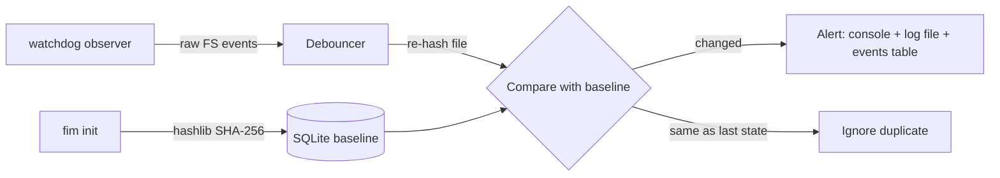

# 🛡️ File Integrity Monitor (FIM)


A lightweight **host-based File Integrity Monitor** written in Python. It builds a trusted
**SHA-256 baseline** of a directory, stores it in **SQLite**, and raises **real-time alerts**
(via `watchdog`) whenever a file is modified, created, deleted or moved — the same idea behind
enterprise tools like Tripwire, OSSEC/Wazuh FIM and AIDE.

> Use case: detect web-shell uploads, website defacement, config tampering or ransomware-style
> mass changes on a server or workstation.

---

## ✨ Features

- 🔐 **Cryptographic hashing** with `hashlib` (SHA-256 default; SHA-512, SHA3-256, BLAKE2b supported), streamed in 64 KiB chunks so huge files use constant memory.
- 🗄️ **SQLite baseline** — multiple directories per database, schema versioning, full **event history**.
- ⚡ **Real-time monitoring** with `watchdog` (inotify / ReadDirectoryChangesW / FSEvents).
- 🧠 **Smart alerting** — debounced events, duplicate suppression, detects **RESTORED** files, handles editors' atomic "save via rename".
- 🕵️ **Offline-change detection** — on start-up it re-scans and reports anything changed while the monitor was off.
- 🎨 **Clear colored terminal alerts** with severity (CRITICAL / WARNING / INFO) + optional **log file** for SIEM ingestion.
- 🤖 **Automation friendly** — `scan --json` and meaningful exit codes for cron jobs / CI pipelines.
- ✅ Tested with `pytest` (unit + real file-system end-to-end tests) on Windows & Linux via GitHub Actions.

## 📸 Demo

```text
== File Integrity Monitor ==
  Directory  C:\lab\demo_site
  Baseline   3 file(s), SHA256, created 2026-11-11T19:01:34+03:00
  Excludes   *.swp, *.swx, *~, .~lock.*#, ~$*

[+] Initial scan clean: all files match the baseline.
[*] Watching for changes in real time... press Ctrl+C to stop.
[2026-11-11 19:01:38] CRITICAL MODIFIED index.html
                      content differs from baseline | baseline 8f12a4a1bbb9 -> current 39979dee879c
[2026-11-11 19:01:40] WARNING  CREATED  uploaded.php
                      file not in baseline | baseline - -> current a78707899451
[2026-11-11 19:01:42] CRITICAL DELETED  notes.txt
                      baseline file deleted | baseline b7d718c10838 -> current -
[2026-11-11 19:01:43] WARNING  MOVED    config/app.ini -> config/app.ini.bak
                      file renamed/moved | baseline f811977a55ae -> current -
[2026-11-11 19:01:46] INFO     RESTORED index.html
                      content matches baseline again | baseline 39979dee879c -> current 8f12a4a1bbb9
```

## 🚀 Quick start

```bash
git clone https://github.com/Youssef840/file-integrity-monitor.git
cd file-integrity-monitor
python -m venv .venv
# Windows: .venv\Scripts\activate     Linux/macOS: source .venv/bin/activate
pip install -r requirements.txt

python -m fim init ./my_folder      # 1. create the trusted baseline
python -m fim watch ./my_folder     # 2. monitor in real time (Ctrl+C to stop)
```

Optionally install it as a command: `pip install .` → then just run `fim watch ./my_folder`.

## 🧰 Commands

| Command | Description |
|---|---|
| `fim init <dir> [-a sha512] [-e GLOB] [--force]` | Hash every file and save the baseline. `--force` re-approves the current state. |
| `fim watch <dir> [--log-file alerts.log] [--debounce 0.5] [--init]` | Real-time monitoring with an initial offline-change scan. |
| `fim scan <dir> [--json]` | One-shot check. Exit code **0** = clean, **1** = changes found, **2** = error. |
| `fim events [<dir>] [-n 50] [--json]` | Show the alert history stored in SQLite. |
| `fim status` | List every baseline stored in the database. |

Common options: `--db PATH` (default `./fim.db`), `-e/--exclude GLOB` (repeatable, e.g. `-e .git -e "*.log"`), `--no-color`.

### Schedule a periodic check (cron)

```bash
*/15 * * * * cd /opt/fim && .venv/bin/python -m fim scan /var/www --json >> /var/log/fim.json || echo "FIM ALERT" | mail -s "Integrity violation" admin@example.com
```

## 🏗️ How it works



| Alert | Severity | Meaning |
|---|---|---|
| `MODIFIED` | CRITICAL | Content hash differs from the baseline |
| `DELETED` | CRITICAL | A file disappeared |
| `CREATED` | WARNING | A new file that is not in the baseline |
| `MOVED` | WARNING | A file was renamed or moved |
| `RESTORED` | INFO | A changed file matches its baseline again |

### Project structure

```text
file-integrity-monitor/
├── fim/
│   ├── cli.py        # argparse CLI (init / scan / watch / events / status)
│   ├── hasher.py     # streaming hashlib hashing with retry on locked files
│   ├── scanner.py    # directory walk, exclusions, baseline diff
│   ├── database.py   # thread-safe SQLite layer (baseline + event log)
│   ├── monitor.py    # watchdog handler, debouncer, alert state machine
│   ├── reporter.py   # colored console + log-file output
│   └── models.py     # dataclasses & enums
├── tests/            # pytest suite (unit + end-to-end)
├── .github/workflows/ci.yml
├── requirements.txt
└── pyproject.toml
```

## 🧪 Running the tests

```bash
pip install -r requirements-dev.txt
pytest            # all tests
ruff check .      # lint
```

## ⚠️ Security notes

- The baseline is only as trustworthy as the moment it was created — run `init` on a known-good system.
- Protect `fim.db`: an attacker who can write to it can forge the baseline. Store it outside the monitored directory, ideally on read-only or separate storage.
- FIM detects changes; it does not prevent them. Pair it with proper permissions, backups and alerting.

## 🗺️ Roadmap

- [ ] Email / Slack / Discord webhook notifications
- [ ] HMAC-signed baseline to detect database tampering
- [ ] Windows service / systemd unit
- [ ] Web dashboard for the event history

## 📄 License

[MIT](LICENSE) © Youssef Hussein
